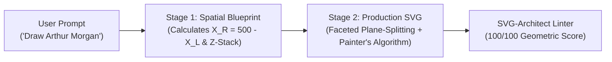

# 📐 SVG-Architect

> **Deterministic Spatial Blueprint Engine for Generative Vector Graphics with LLMs.**  
> *Stop letting language models hallucinate coordinates. Enforce mathematical symmetry, plane-splitting volume, and strict Painter's Algorithm Z-stacks.*

<p align="center">
  
  
  
  
</p>

---

## ⚡ The Problem with AI-Generated SVGs

When prompted to "Draw Batman" or "Generate an SVG character", LLMs (GPT-4, Claude, Gemini) notoriously fail:
1. **Spatial Drift & Asymmetry:** LLMs eyeball coordinates token-by-token. Left and right eyes end up with different radii, floating ears, and skewed jawlines.
2. **Flat Vector Mud:** Single flat fills (`fill="#ff0000"`) with zero ambient occlusion, no specular rim lighting, and no faceted planes.
3. **Occlusion Hell (Painter's Algorithm Violations):** Layers render in random order—necks drawn on top of heads, ears hidden under backgrounds.

## 🎯 The Solution: The Spatial Blueprint Protocol

`svg-architect` solves spatial hallucination by forcing LLMs to execute a **deterministic Mathematical Pre-Computation** *before* emitting XML:



---

## 🚀 Benchmark Comparison (Zero-Shot vs. Architect)

All benchmarks can be inspected live with **Grid Overlay** and **Wireframe Mode** via `svg-architect serve`:

| Character | Stage A: Baseline Zero-Shot LLM | Stage B: SVG-Architect Engine |
| :--- | :--- | :--- |
| **Arthur Morgan** *(RDR2)* | Flat brown blob, disconnected eyes, no shading | **Rockstar High-Contrast Poster Art:** Pinched leather gambler hat, deep cast shadow, red silk bandana, and outlaw riders on horseback |
| **Spider-Man** | Disjointed spider web mud, flat circles | **Queens Web-Warrior:** Radial web matrix centered at `[250, 242]`, pearlescent silver mesh lenses, 8-legged chest emblem |
| **Batman** | Skewed horns, flat gray mask | **The Dark Knight:** Titanium slate vs. void obsidian plane-splitting down `X = 250`, razor bat ears, cyan slit eyes |
| **Garfield** | Weird canine snout, flat circles | **Jim Davis Classic Comic:** True burger-bun cranium, touching egg eyes at `X = 250`, cream whisker jowls |

---

## 🛠️ Features

* **Deterministic Symmetry Mirroring:** Exact mathematical counterpart calculation (`X_R = 500 - X_L`) preventing facial drift.
* **Plane Splitting (Anti-Flatness):** Splits vertical axes into light-facing (`L`) and core-shadow (`R`) facets.
* **Painter's Algorithm Linter:** Validates DOM ordering (`<defs>` $\rightarrow$ Atmosphere $\rightarrow$ Midground $\rightarrow$ Foreground Details).
* **Built-in Quality Linter:** Scores any SVG out of 100 on geometric cleanliness, gradient usage, filter presence, and node density.
* **Interactive Benchmark Viewer:** Dark-mode comparison suite with 16/64px SVG mathematical grid overlays, wireframe inspector, and DOM size analyzer.

---

## 📦 Installation

```bash
# Clone the repository
git clone https://github.com/shayanmahster/svg-architect.git
cd svg-architect

# Install locally
pip install -e .
```

---

## 💻 CLI Quickstart

### 1. Launch the Interactive Benchmark Dashboard
```bash
svg-architect serve --port 8000
```
*Opens the local gallery featuring Arthur Morgan, Spider-Man, Batman, and Garfield with live Grid Overlay and Wireframe inspection.*

### 2. Lint any SVG for Architectural Hygiene
```bash
svg-architect lint viewer/samples/arthur_morgan.svg
```
```text
==================================================
 SVG Architect Linter: arthur_morgan.svg
==================================================
Score:            100 / 100
Valid XML:        PASS
Total DOM Nodes:  116
Defs Elements:    9
Gradients Found:  YES
Filters Found:    YES
Center Split:     YES
File Size:        12.46 KB
--------------------------------------------------
Clean Architecture! Zero geometric or ordering violations detected.
==================================================
```

### 3. Generate a Spatial Blueprint Prompt for any LLM
```bash
svg-architect prompt "Cyberpunk Samurai Mask"
```

---

## 🐍 Python SDK Usage

```python
from svg_architect import SpatialBlueprint, SVGLinter

# 1. Define a Deterministic Blueprint
blueprint = SpatialBlueprint(view_box="0 0 500 500", canvas_width=500)
blueprint.add_anchor(name="Cheekbone Outer", x_left=145, y=230)
blueprint.add_anchor(name="Eye Center", x_left=205, y=190)

print(blueprint.render_markdown_spec())

# 2. Lint an AI-generated SVG
report = SVGLinter.lint("<svg>...</svg>")
print(f"Quality Score: {report.score_out_of_100}/100")
```

---

## 📐 The Core Rules

1. **The Sacred Center Axis (`X = 250`):** Every symmetric feature follows `X_R = 500 - X_L`.
2. **Strict Z-Index Ordering:**
   - `Layer 0`: Atmosphere & Background
   - `Layer 1`: Back Silhouette & Cape/Hair
   - `Layer 2`: Neck & Structural Connectors
   - `Layer 3`: Primary Structural Mass (Plane-split down `X = 250`)
   - `Layer 4`: Faceted Shading & Secondary Volume
   - `Layer 5`: Focal Foreground Details (Eyes, specular glints, 1px rim lights)
3. **Angular Dominance (`L` Commands):** Prioritize explicit polygons over wandering cubic beziers for structural anatomy.

---

## 🤝 Contributing

Contributions, preset additions, and model harnesses (Claude 3.5, Gemini 1.5/2.0, GPT-4o) are welcome!

1. Fork the Project
2. Create your Feature Branch (`git checkout -b feature/AmazingVector`)
3. Commit your Changes (`git commit -m 'Add AmazingVector'`)
4. Push to the Branch (`git push origin feature/AmazingVector`)
5. Open a Pull Request

---

## 📄 License

Distributed under the MIT License. See `LICENSE` for more information.

Developed by [@shayanmahster](https://github.com/shayanmahster).
